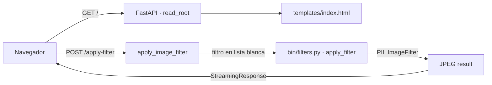

# img-api

API en Python para aplicar filtros de imagen usando **Pillow**, con una interfaz web (FastAPI) para subir una imagen, elegir un filtro y recibir el resultado en JPEG.

[](https://python.org)
[](https://fastapi.tiangolo.com)

## Contenido

- [Características](#características)
- [Arquitectura](#arquitectura)
- [Stack](#stack)
- [Estructura del repositorio](#estructura-del-repositorio)
- [Instalación](#instalación)
- [Uso](#uso)
- [Roadmap](#roadmap)
- [Licencia](#licencia)

## Características

- Formulario HTML (`templates/index.html`) para subir una imagen y seleccionar un filtro.
- **10 filtros** del módulo `PIL.ImageFilter`: `blur`, `contour`, `detail`, `edge_enhance`, `edge_enhance_more`, `emboss`, `find_edges`, `sharpen`, `smooth`, `smooth_more`.
- Validación del filtro mediante lista blanca (evita valores arbitrarios).
- Devolución del resultado como imagen JPEG vía `StreamingResponse`.
- Preparado para deploy con `uvicorn`/`gunicorn` (ver `Procfile`).

## Arquitectura



## Stack

| Componente | Tecnología                                   |
|------------|----------------------------------------------|
| Lenguaje   | Python 3                                     |
| API        | FastAPI 0.65, uvicorn 0.14                    |
| Imágenes   | Pillow 8.2                                    |
| Frontend   | Jinja2 3.1 (Bootstrap)                        |

## Estructura del repositorio

```
img-api/
├── main.py             # App FastAPI + endpoints
├── bin/
│   └── filters.py      # Lógica de filtros (Pillow)
├── templates/
│   └── index.html      # Formulario de subida
├── requirements.txt
├── Dockerfile          # Imagen de desarrollo (devcontainer)
├── Procfile            # web: uvicorn main:app
└── time_test.py        # Benchmark de tiempos de filtros
```

## Instalación

```bash
git clone https://github.com/bi0punk/img-api.git
cd img-api
python -m venv .venv && source .venv/bin/activate
pip install -r requirements.txt
```

## Uso

```bash
uvicorn main:app --reload
# o con gunicorn/Procfile:
uvicorn main:app --host 0.0.0.0 --port 5000
```

Abre `http://localhost:8000`, sube una imagen, elige un filtro y descarga el resultado.

Probador de tiempos:

```bash
python time_test.py
```

## Roadmap

- [x] 10 filtros de Pillow con validación por lista blanca
- [x] Interfaz web de subida y descarga
- [x] Config de deploy (Devcontainer + Procfile)
- [ ] Más filtros y parámetros (intensidad, kernel)
- [ ] Descarga del original + comparativa antes/después
- [ ] Exportación en PNG/WebP
- [ ] Docker Compose de producción (uvicorn + gunicorn)

## Licencia

Sin archivo `LICENSE` declarado en el repositorio.